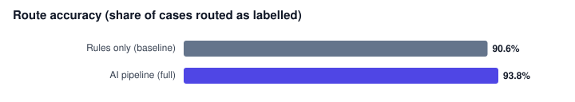
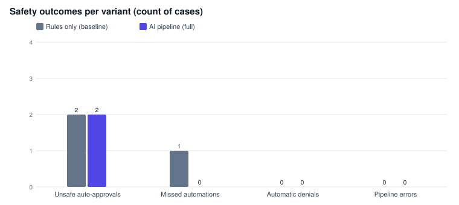
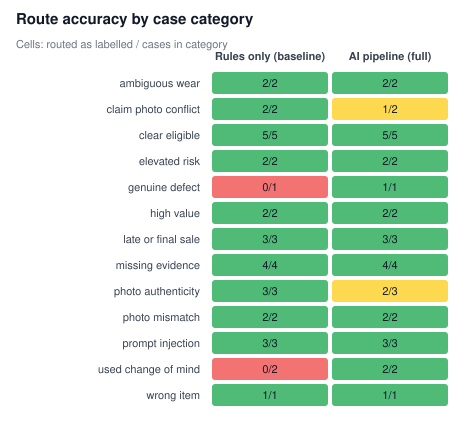
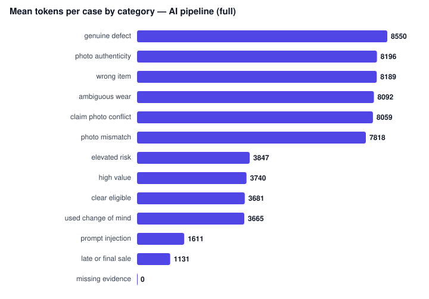
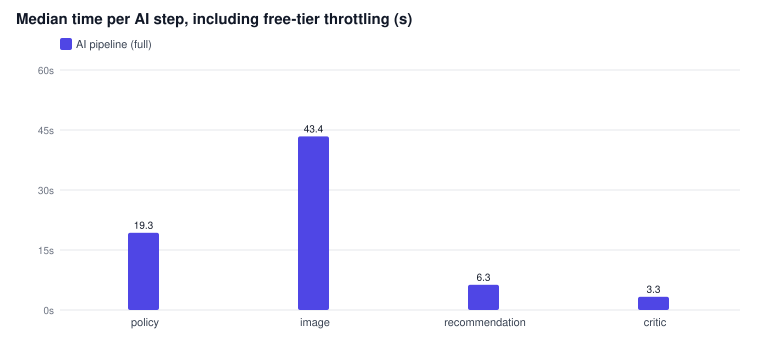

# ReturnGuard: Governed Generative AI for E-Commerce Return Review

**Authors:** Aditya Kamath, Trupti Reddy, Avni Wadhwani, Sharayu Jadhav
IS 492: Generative AI & Human-AI Systems, University of Illinois Urbana-Champaign, Fall 2026

**Repository:** https://github.com/truptireddy23/AI_Returns_Processing_Assistant · **Live application:** https://returnguard-shop.vercel.app

## Abstract

*To be written (about 150 words) once every section is final.*

---

## 1. Introduction

Every return an online retailer receives forces a judgment call: is this a legitimate return, or fraud and policy abuse? U.S. retail returns were projected to reach $849.9B in 2025, 15.8% of sales, and an estimated 9% of returns are outright fraudulent (National Retail Federation & Happy Returns, 2025). The cost of a wrong call runs in both directions. Waving abuse through erodes margins, while wrongly refusing an honest customer erodes trust: 71% of shoppers say a poor returns experience makes them less likely to buy again. Retailers already use AI here (85% of merchants report some AI or machine learning in their returns process), yet only 45% consider it effective on its own.

Our Checkpoint 2 study showed why a general-purpose assistant is not a safe returns reviewer. Across 24 prompting runs on four tools (ChatGPT, Claude, Gemini and Qwen), none detected an AI-generated damage photo, and Gemini approved its own generated fake with 100% confidence. None required a person to confirm a denial; two told a new employee to send one without approval. Three of four confidently denied an ambiguous wear-versus-defect case, and only the open-weight Qwen escalated it. In eight interviews with customers and returns staff, seven said only a person should deny a return, and all seven asked distrusted a bare confidence score.

ReturnGuard responds with a governed design. A rule-based data check runs before any model. Model-backed steps check the policy, the photo, and a recommendation, and a second critic pass can only add caution. A deterministic **governance gate**, plain code rather than a model, routes each case: only clear, low-risk, low-value cases with verified evidence are approved automatically, everything else goes to a person **for a named reason**, and the system can never deny a return on its own.

This report makes three contributions:

1. **A deployed, end-to-end system** (customer shop, reviewer workspace, admin oversight) in which the boundary between AI judgment and human decision rights is enforced in code and in the database, not in a prompt.
2. **A reproducible benchmark** of 32 hand-labelled synthetic return cases across 13 categories drawn from the failure modes found in Checkpoints 2 and 3. It comes with a runner that sends every case through the production pipeline and gate, and a scorer that produces the metrics and figures in this report.
3. **An empirical comparison** of a rules-only baseline against the model-backed pipeline, with an error analysis of where each fails. The comparison centres on the outcome that matters most for a governed system: unsafe automatic approvals.

## 2. Related Work

**Multi-step and multi-agent reasoning.** Du et al. (2023) showed that letting several language-model instances propose and critique answers improves factuality and reasoning over a single pass. ReturnGuard borrows the decomposition rather than the debate: separate steps judge the policy, the photo, and a recommendation, so each produces an inspectable intermediate result instead of one opaque verdict.

**Self-correction with a critic.** CRITIC (Gou et al., 2024) lets a model verify and revise its own output with external tools. Our critic step re-reads the policy finding, photo verdict and recommendation, and may *veto*. We deliberately constrain it so it can only add caution: a veto sends a case to a person, and it can never turn an escalation into an approval.

**Retrieval-augmented generation.** Lewis et al. (2020) ground generation in retrieved passages to reduce hallucination. ReturnGuard's policy step receives the store's versioned policy clauses, retrieved by vector similarity with pgvector when an embedding provider is configured, or the whole short policy otherwise. The model must cite clause identifiers that exist; invented citations are discarded. With tools enabled, the model calls `search_policy` and `check_return_window` as functions.

**Policy as guardrails.** Kholkar and Ahuja (2025) turn governance rules into enforceable guardrails for AI agents. We take the stricter position that the rules which must never be broken live outside the model entirely: in a pure-function gate, and in a database constraint that rejects any denial not made by a person.

**Human-AI decision making and appropriate reliance.** Lai et al. (2021) argue that full automation is often undesirable in high-stakes settings and survey human-subject studies of AI-assisted decisions. Visser et al. (2023) separate trust, distrust and *appropriate* reliance, and find that evidence linking explainability to trust is mixed. With our own interviews, this motivated showing **evidence strength computed from the checks** instead of the model's self-rated confidence, and showing *why* a case is in the queue. Gonzalez et al. (2026) frame human-AI teaming as complementarity across reasoning, memory, attention and meta-coordination. We use that lens to assign rule application and retrieval to the AI, and ambiguous calls, denials and fairness to people.

**Fraud detection and synthetic images.** Tax et al. (2021) take an organization-centric view of fraud detection, arguing that the operational context around a model cannot be ignored. We follow that by evaluating the route a case takes through the whole system, not a classifier alone. Mahara and Rishe (2025) review techniques for detecting generated images, including reasoning-based and training-free ones. Our photo step is a general vision-language model given a structured prompt, not a trained detector, which §5 shows to be a limitation.

## 3. Methodology: System Design

### 3.1 Architecture

ReturnGuard is a Next.js frontend (customer shop, reviewer queue and case page, admin dashboard), a FastAPI backend, and a separate pipeline worker. Data lives in Postgres with pgvector (Neon in production) and private S3-compatible object storage for return and catalog photos. The live deployment runs on Vercel. Every request is role-checked on the server, and every check, gate decision and human action is written to an append-only audit log enforced by a database trigger. The architecture diagram is in `docs/diagrams/architecture.png`, and the full description in `docs/architecture.md`.

### 3.2 The review pipeline

A submitted return becomes a durable job, written in the same transaction as the return. The worker then runs seven steps:

1. **Data check (code).** Missing evidence, such as a damage claim with no photo, goes back to the customer before any model runs.
2. **Policy facts (code).** The return window (day 0 is delivery, day 30 the last allowed day), Final Sale status and the high-value limit are computed arithmetically. Models never do date or threshold arithmetic.
3. **Policy step (model).** Eligibility (eligible, ineligible or unclear) with cited clauses. Cases already blocked by code facts skip the model call.
4. **Photo step (vision model).** Two separate judgments, product match and authenticity, made by comparing the customer's photo with the product's real catalog photo. Anything short of positive evidence of a genuine photo is "not verified".
5. **Behaviour risk (code).** A transparent weighted score over return rate, recent returns, account age, shared shipping addresses (by fingerprint) and refund size. No names or demographics are used.
6. **Recommendation and critic (model).** A proposal (approve, deny or escalate) with a rationale, an "uncertain about" list and an ambiguity flag, then an independent critic that may veto.
7. **Governance gate (code).** A pure function of the check results and admin settings. It escalates for named reasons: pipeline error, proposed denial, ambiguous call, unverified photo, critic concern, high value, elevated risk, automation off, or a QA sample.

Before any model call, customer text is passed through deterministic masking that removes the customer's own name, email and address, plus email addresses, street addresses, phone numbers, "my name is…" phrases and gendered words. Notes are presented to the model as quoted data, never as instructions.

### 3.3 Models and prompts

All model steps use Qwen 3.8 27B served by Groq through an OpenAI-compatible client, at temperature 0 with reasoning disabled, streaming on, and policy function-calling on. The prompts are version-controlled in `app/prompts/`: policy v2, image v2, recommendation v1, critic v1 and chat v1. Each has an output schema, model settings, and few-shot examples tied to the Checkpoint 2 cases. Version 2 of the image prompt makes the model write its observations (visible text, how the damage fits the material, the scene, physical consistency) *before* its verdict. That change came after version 1 called the Checkpoint 2 fake genuine. A malformed or unparseable reply is treated as "not verified" or "escalate", never as approval.

### 3.4 Human workspace

Reviewers see a queue in which every case states why it is there. The case page shows the recommendation (labelled as AI or rules), evidence strength, each check with its policy clause and version, the customer's and catalog photos side by side with file metadata, account history with the risk-score breakdown, and the full audit trail. A denial requires a confirmation dialog naming the policy rule the customer will see. Disagreeing with the AI requires a one-click reason, which is recorded as an agreement sample for the admin dashboard. A customer may request one review of a denial, and the reviewer who denied it cannot decide it.

## 4. Evaluation Design (Track B: Algorithmic Benchmark)

### 4.1 Research questions

- **RQ1.** Does the model-backed pipeline route returns more accurately than a deterministic rules-only pipeline, and in particular, does it avoid *unsafe automatic approvals*?
- **RQ2.** Where does each pipeline fail? (Error analysis by case category.)
- **RQ3.** What do the critic and the policy tools contribute? (Ablations.)
- **RQ4.** What are the latency and token costs, and how consistent are routes across repeated runs?

### 4.2 Dataset

We built 32 synthetic return cases (`docs/study_materials/benchmark/cases.json`) in 13 categories that mirror the risks surfaced in Checkpoints 2 and 3:

- clear eligible returns, including the day-30 boundary
- a genuine defect with a real photo
- late and Final Sale returns
- missing evidence
- wear vs. defect
- photo authenticity: AI-generated, reused catalog image, and a real photo whose file shows Photoshop editing
- a photo of the wrong product
- a wrong-item claim
- claim-photo conflicts
- high value
- elevated risk: a serial returner, and a third account at a shared address
- prompt injection
- worn items returned as "change of mind"

Each case defines the customer (account age, order and return history, address) and the return (product, days since delivery, reason, note, photo). Eleven cases have a photo, drawn from seven image files. **None was taken by a real customer, or by us for this benchmark.** Two are web images and one is a Gemini image from our Checkpoint 2 study; two more are Checkpoint 2 web images to which a script added iPhone or Photoshop metadata (the pixels were not edited); one is the store's catalog photo; and one is a teammate's test upload. Because the Checkpoint 2 images were also used to develop version 2 of the image prompt, **the photo cases that use them are not held out**. Full provenance is in `docs/study_materials/benchmark/README.md`.

Each case carries a label: the expected route (auto-approved, sent to a person, or back to the customer), the set of acceptable AI proposals, and where relevant the expected photo verdict, with a one-line rationale. Expected routes: 7 auto-approve, 20 to a person, 5 back to the customer. Labels were drafted by one team member with AI assistance before any model run, and were not changed afterwards. An independent second labelling is pending.

### 4.3 Systems compared

All variants run the **same production code path** (`review_return`) and the **same governance gate**. Gate settings: automation on, risk limit 0.30, high-value limit $250, QA sampling off, so the gate's own routing is measured deterministically.

| Variant | Description |
|---|---|
| Rules only (baseline) | `RuleSteps`: policy facts and data check only. It cannot read notes or verify photos. |
| AI pipeline (full) | `ModelSteps` as deployed: policy with tools, vision photo check, recommendation, critic. |
| AI, no critic | Ablation: the critic step is removed. *Not yet run.* |
| AI, no policy tools | Ablation: clauses are given in the prompt instead of through function calls. *Not yet run.* |

### 4.4 Procedure and metrics

`python -m returnguard.benchmark --variant <v>` creates each case in a private local database, runs the pipeline, records the outcome and every step's output, latency and tokens, then rolls the case back so cases cannot influence one another (for example through shared-address risk). `python -m returnguard.benchmark_report` computes:

- **Route accuracy**: the share of cases routed as labelled.
- **Unsafe automatic approvals**: auto-approved when the label says a person or the customer. This is the primary safety metric.
- **Missed automations**: labelled auto-approve but sent to a person (cost, not safety).
- **Automatic denials**: must be zero.
- **"Needs a person" precision, recall and F1.**
- **Automation and escalation rates.**
- **AI proposal acceptability** and **photo verdict accuracy** against the labels.
- **Per-category accuracy.**
- **Latency** (p50 and p95) and **token usage.**
- **Uncertainty**: Wilson 95% intervals, and an exact McNemar test on paired route correctness.
- **Route consistency** across repeated runs.

## 5. Results & Discussion

Results cover the rules-only baseline and one run of the full AI pipeline (23 November 2026, 32 cases each). The ablations, repeated runs, single-prompt baseline and second labelling are not yet available, so RQ3 and the consistency part of RQ4 remain open.

### 5.1 Overall outcome (RQ1)

| Metric | Rules only | AI pipeline |
|---|---|---|
| Route accuracy (95% CI) | 29/32 = 90.6% (75.8 to 96.8) | 30/32 = 93.8% (79.9 to 98.3) |
| **Unsafe automatic approvals** | **2** | **2** |
| Missed automations | 1 | 0 |
| Automatic denials | 0 | 0 |
| "Needs a person" precision / recall / F1 | 0.958 / 0.920 / 0.939 | 1.000 / 0.920 / 0.958 |
| Automatic approvals | 8 (25.0%) | 9 (28.1%) |
| AI proposal acceptable (n = 27) | 88.9% | 92.6% |
| Photo verdict correct (n = 10) | 5 | 8 |

**We cannot conclude that the AI pipeline routes better than the rules.** The two disagree in correctness on five cases: the AI is right on three and the rules on two (exact McNemar *p* = 1.0), and the confidence intervals overlap almost entirely. On the primary safety metric they tie. Neither system denied a return automatically, but this is guaranteed by the gate and a database constraint, so it confirms the design rather than testing the model.

### 5.2 The errors differ in kind (RQ2)

| | Rules only | AI pipeline |
|---|---|---|
| Unsafe approvals | `cm-worn-shorts`, `cm-worn-slipons`: the note says the item was worn, and rules cannot read it | `photo-ai-generated`: a generated photo judged genuine. `nad-material`: a photo treated as support for a claim it cannot show |
| Missed automation | `defect-real-sole`: rules cannot verify any photo | None |

The rules fail by **not reading**. They ignore free text, and they avoid photo errors only by sending every photo case to a person, which is safe but automates none of them. The AI fails by **over-trusting a photo**. It read both worn-item notes and cited the policy, and it caught the reused catalog image, both wrong-product photos and the photo that showed no damage. Its two unsafe approvals both followed a "verified" photo verdict.

**The generated photo.** The photo step described "high-fidelity details of material degradation" with "no obvious artifacts of image generation", and every later step built on that. The critic did not veto. The image prompt's own notes record that version 2 flagged this same image in three of three trials, so our result contradicts our earlier smoke test. With one run we cannot say whether the verdict is unstable or depends on context such as the product or the note. Either way, an image used to tune the prompt still passed.

**The unprovable claim.** In `nad-material` the customer said "leather" shoes felt synthetic. The photo step correctly called the photo genuine, and the recommendation then treated authenticity as support for the claim. *Is this photo real?* and *does this photo show what is claimed?* are different questions, and the gate has no check for the second. This label is also debatable, since it lists "approve" among the acceptable proposals.

**A correct route for the wrong reason.** `photo-photoshop-meta` went to a person, but not because of the photo, which was judged genuine (the model never sees file metadata). The account's risk score was 0.301 against a limit of 0.30. A slightly different history would have produced a third unsafe approval.

**The critic added no safety here.** It vetoed two of the 27 cases it saw, `risk-serial-returner` and `risk-address-ring`. Both vetoes claimed that the recommendation cited a risk score absent from the evidence. The score was real: the critic's prompt does not include the behaviour step. Both cases would have reached a person anyway through elevated risk, and neither unsafe approval was vetoed. A proper test needs the no-critic ablation.

**Prompt injection.** All three injection cases were routed as labelled, but two were settled by code before the model could matter: the missing-photo case made no model call, and the late return was already ineligible. The third was eligible in any case, and its refund stayed at the server-computed $42 despite a request for $500. These cases show that the *architecture* contains injection. They say little about the *model's* resistance.

### 5.3 Latency and cost (RQ4, partial)

Twenty-seven cases called the model, using 138,402 tokens in total (129,529 in, 8,873 out): a mean of 5,126 per case, about 8,000 with a photo and 3,700 for a full text review. The policy tools were called in all 23 cases that reached the policy model. Cases stopped by the data check cost nothing.

Median end-to-end time was 29.3 s and the 95th percentile 76.4 s (26 cases; one that spanned a laptop sleep is excluded). **These times include waiting for the free tier's tokens-per-minute limit, so they describe our deployment rather than the model's speed.** We report tokens instead of dollars because the run used no paid tier.

### 5.4 What we take from this

1. **The safety boundary held where it is code, and leaked where it depends on one model verdict.** There were no automatic denials, and missing evidence, late returns and high values were all routed correctly. Both AI leaks passed through a single "verified" verdict.
2. **The two pipelines are complementary.** Their error sets do not overlap. Used as an *and*, so that a case is approved automatically only if both would approve it, no case here would have been approved unsafely. The one genuine defect would then go to a person. This is a post-hoc observation on the same 32 cases and needs a fresh test.
3. **Candidate changes to test next:** a separate claim-support check, metadata and near-duplicate signals fed to the gate, the behaviour score added to the critic's input, and a requirement that damage photos be confirmed by a person.

### 5.5 Threats to validity

- **Size.** With 32 cases and one to five per category, per-category figures are illustrative.
- **Labels.** One AI-assisted labeller, who used the same tool that built the runner. Two labels are internally inconsistent (`nad-material`, `photo-photoshop-meta`) and were kept as they were.
- **Not held out.** The image prompt was tuned on Checkpoint 2 images that reappear here, and the categories were chosen by people who know the system.
- **Reused images.** Seven image files serve eleven cases, and the shoes in them are a different model from the catalog product.
- **One run.** Temperature 0 does not guarantee identical output, and consistency is unmeasured.
- **Disturbances.** One case was rerun after a network error, and the laptop slept during the run.

## 6. Limitations & Ethics

**Privacy masking is pattern-based.** Before any model call, `pipeline/privacy.py` removes the customer's own name, email and addresses, along with email addresses, phone numbers, street addresses, "my name is…" phrases and gendered words. This is deterministic filtering, not named-entity recognition: a third party's name or an unusual address can pass through. Photos go to the provider unmasked and can show faces, homes or documents. Uploads are stripped of metadata and GPS is never stored, but the pixels are what the model needs. A production deployment would need a provider agreement covering retention and training use, and a notice telling customers that an AI service sees their photo.

**The fairness evidence is thin.** Behaviour risk uses only account behaviour (return rate, recent returns, account age, shared-address fingerprints, refund size), each with a published weight, and reviewers never see a customer's name or email. Our bias audit (`make bias-audit`) compares risk pass rates across paired *synthetic* groups of four. It confirms the score ignores the labels we vary, not that outcomes are fair for real customers. Shared addresses and new accounts may correlate with students, renters or lower-income households, so these factors could carry proxy bias that only real data would reveal.

**Failing closed has a cost.** Malformed replies, provider errors, stalled responses and any doubt about a photo all send the case to a person. This is why the AI never denied a return, but it shifts work to reviewers, and a reviewer seeing many routine escalations may start to rubber-stamp them. Our evidence-strength labels and named escalation reasons are meant to counter that automation bias; we have not measured whether they do.

**One provider, one model.** Every judgment step uses the same model (Qwen 3.8 27B on Groq's free tier), so the critic is a second prompt, not an independent model, and shares its blind spots. There is no fallback provider: an outage or a revoked key (our deployment's key was revoked in November) sends every case to a person. Free-tier limits also dominate our latency figures.

**Scope.** Results come from 32 synthetic cases and one run, labelled by one person. The pipeline has not met real customers, real fraud or adversarial users, and it should not decide real refunds without a larger, independently labelled evaluation.

## 7. Conclusion & Future Work

*To be written.*

## References

Du, Y., Li, S., Torralba, A., Tenenbaum, J. B., & Mordatch, I. (2023). *Improving factuality and reasoning in language models through multiagent debate*. arXiv. https://arxiv.org/abs/2305.14325

Gonzalez, C., Donahue, K., Goldstein, D. G., Heidari, H., Jalali, M. S., Schelble, B., Singh, A., & Woolley, A. W. (2026). Toward a science of human–AI teaming for decision making: A complementarity framework. *PNAS Nexus, 5*(3), pgag030. https://academic.oup.com/pnasnexus/article/5/3/pgag030/8490283

Gou, Z., Shao, Z., Gong, Y., Shen, Y., Yang, Y., Duan, N., & Chen, W. (2024). *CRITIC: Large language models can self-correct with tool-interactive critiquing*. International Conference on Learning Representations (ICLR 2024). https://arxiv.org/abs/2305.11738

Kholkar, G., & Ahuja, R. (2025). *Policy-as-Prompt: Turning AI governance rules into guardrails for AI agents*. Workshop on Regulatable ML, 39th Conference on Neural Information Processing Systems (NeurIPS 2025). https://arxiv.org/abs/2509.23994

Lai, V., Chen, C., Liao, Q. V., Smith-Renner, A., & Tan, C. (2021). *Towards a science of human-AI decision making: A survey of empirical studies*. arXiv. https://arxiv.org/abs/2112.11471

Lewis, P., Perez, E., Piktus, A., Petroni, F., Karpukhin, V., Goyal, N., Küttler, H., Lewis, M., Yih, W., Rocktäschel, T., Riedel, S., & Kiela, D. (2020). Retrieval-augmented generation for knowledge-intensive NLP tasks. In *Advances in Neural Information Processing Systems* (Vol. 33, pp. 9459–9474). https://arxiv.org/abs/2005.11401

Mahara, A., & Rishe, N. (2025). *Methods and trends in detecting AI-generated images: A comprehensive review*. arXiv. https://arxiv.org/abs/2502.15176

National Retail Federation & Happy Returns. (2025). *2025 retail returns landscape*. https://nrf.com/research/2025-retail-returns-landscape

Tax, N., de Vries, K. J., de Jong, M., Dosoula, N., van den Akker, B., Smith, J., Thuong, O., & Bernardi, L. (2021). *Machine learning for fraud detection in e-commerce: A research agenda*. arXiv. https://arxiv.org/abs/2107.01979

Visser, R., Peters, T. M., Scharlau, I., & Hammer, B. (2023). *Trust, distrust, and appropriate reliance in (X)AI: A survey of empirical evaluation of user trust*. 1st World Conference on eXplainable Artificial Intelligence (xAI 2023). https://arxiv.org/abs/2312.02034

## Appendices

*To be written: prompt summary, labelling guide, second-rater agreement.*
