# ReturnGuard — Architecture

> Status as of this document: **M1–M8 are merged to `main`** (skeleton, data model/auth,
> shop/checkout/return submission, pipeline runner + governance gate + worker, reviewer
> queue + case decisions + claiming, admin settings + dashboard + audit log, real catalog
> photos). The judgment steps themselves (Policy RAG, photo authenticity, recommendation,
> critic) are real model calls on this branch, wired into `worker.py`'s default — see
> [§3](#3-the-pipeline) — falling back to the deterministic `RuleSteps` stand-in whenever
> `OPENAI_API_KEY` isn't configured, so the app always runs, honestly, either way. See
> [§5](#5-what-is-and-isnt-real-right-now) for the full breakdown, and `DESIGN_SPEC.md` for
> the product and UX design this architecture implements.

---

## 1. System diagram

```mermaid
flowchart TB
    subgraph Client
        WEB[Next.js frontend<br/>shop · cart · checkout<br/>returns · review queue · admin dashboard]
    end

    subgraph Backend ["FastAPI backend (app/backend)"]
        API[API routers<br/>catalog · orders · returns · review · admin]
        AUTH[auth.py — sessions, roles, rate limiting]
        IMG[images.py — photo validation + storage]
        PAY[payments.py — test-card checkout, no real money]
        WORKER[worker.py — claims jobs, runs the pipeline<br/>wakes on an API HTTP call, not polling]
        PIPE["pipeline/* — checks, gate, behavior, steps, runner<br/>RuleSteps and ModelSteps, both merged"]
    end

    subgraph Data ["Postgres 16 + pgvector (Neon hosted, or local Docker)"]
        PG[(users · orders · returns · review_requests<br/>policy_docs · policy_chunks[vector] · product_photos<br/>jobs · agent_runs · audit_log · settings)]
    end

    subgraph Storage ["Object storage (Neon, S3-compatible)"]
        S3[(return-photos — customer uploads<br/>product-photos — real catalog photos)]
    end

    subgraph Models ["OpenAI (or any OpenAI-compatible endpoint)"]
        LLM[["Chat: policy / photo / recommendation / critic"]]
        EMB[["Embeddings: policy_chunks.embedding"]]
    end

    WEB -- "/api/*, same-origin proxy" --> API
    API --> AUTH
    API --> IMG
    API --> PAY
    API -- "queues a job, wakes the worker over HTTP" --> WORKER
    WORKER --> PIPE
    API --> PG
    WORKER --> PG
    IMG --> S3
    PIPE -- "ModelSteps, when OPENAI_API_KEY is set" --> LLM
    PIPE -- "ModelSteps.policy()" --> EMB
    PIPE -- "ModelSteps.photo(): customer photo + catalog reference" --> S3
    EMB -. "writes" .-> PG
```

## 2. Layers

### 2.1 Frontend — `app/frontend` (Next.js, App Router)

Server-rendered pages under `src/app/`: `shop` (product gallery, real catalog photos with an
illustration fallback), `cart`, `orders` (+ order detail with billing address), `returns/new/[itemId]`
(start a return), `returns/[id]` (status, with **Request a review** once denied), `review`
(reviewer queue with tabs, claim, decide) and `review/cases/[id]` (full case page), `admin`
(editable automation settings, dashboard, audit log), plus `login`/`signup`. `src/app/api/[...path]/route.ts`
proxies `/api/*` to the FastAPI backend same-origin, so the browser never talks to the API host
directly. Role gating is client-side (`components/require-role.tsx`) backed by server-side role
checks on every endpoint. A typed API client (`lib/api.ts`, `lib/api-schema.d.ts`) is generated
from the backend's OpenAPI schema (`make api-types`) so the two can't silently drift.

### 2.2 Backend — `app/backend` (FastAPI, Python, `uv`)

- **Routers** (`src/returnguard/routers/`): `catalog` (browse products, serve catalog
  photos), `orders` (checkout, list/detail), `returns` (submit a return + photo, request a
  review of a denial, list/detail, status), `review` (queue, claim/release, case detail,
  decide), `admin` (settings read/write, dashboard metrics, audit log). Each endpoint is
  backed by a real Postgres query — nothing here is mocked.
- **Cross-cutting**: `auth.py` (session cookies, Argon2 password hashing, role checks),
  `security.py`, `ratelimit.py` (per-address/per-account limits on sign-in and sign-up),
  `images.py` (validates and stores uploaded return photos), `product_photos.py` (uploads
  and re-encodes real catalog photos, with a perceptual hash for the photo check),
  `payments.py` (test-card checkout only — card number `4242 4242 4242 4242`; no real
  payment processor is called), `storage.py` (S3-compatible client over two private
  buckets — `return-photos` and `product-photos` — Neon Object Storage in hosted mode,
  local disk otherwise), `audit.py` (append-only audit log writes), `log_config.py`
  (structured JSON logs with a request ID on every line via `structlog` + `asgi-correlation-id`).
- **Worker** (`worker.py`): a separate process from the API. It claims rows from the
  `jobs` table (`FOR UPDATE SKIP LOCKED`, so multiple workers can run safely) and runs the
  pipeline on each queued return. The API wakes the worker over HTTP the moment it queues a
  job, rather than having the worker poll the database on a timer — Neon suspends the
  database after a few idle minutes, and a periodic poll would keep it awake (and billing)
  around the clock. A long backstop sweep (`WORKER_SWEEP_SECONDS`, default 30 min) catches a
  missed wake-up.
- **Pipeline** (`pipeline/`): see [§3](#3-the-pipeline).

### 2.3 Database — Postgres 16 + pgvector

One schema, two interchangeable targets controlled by `DATABASE_URL`: **Neon** (hosted,
shared team data + live demo) or **local Docker Postgres** (offline work; tests always use
their own local `returnguard_test` database regardless of which one `DATABASE_URL` points
at). Alembic migrations (`app/backend/alembic/versions/`) are the only way the schema
changes. Tables that matter for the AI pipeline specifically:

| Table | Purpose |
|---|---|
| `policy_docs` / `policy_chunks` | The versioned return policy, pre-split into clauses (`P1`…`P9`). `policy_chunks.embedding` is a `vector(1536)` column, filled in by `make embed-policy` once `EMBEDDING_API_KEY` is set (optional: without it the whole policy is sent instead). |
| `product_photos` | Real uploaded catalog photos per product (first = main photo), with a source hash (skip re-upload) and a perceptual hash (near-duplicate comparison for the photo check). |
| `jobs` | Durable work queue for the pipeline; one row per return, claimed by the worker. |
| `agent_runs` / `agent_run_events` | One row per pipeline step execution: which step, which model (`null` when that step ran on `RuleSteps`), prompt version, policy version, input hash, token counts, cost, latency, and any error. `source` ("rules" vs. "model") is the authoritative answer to "did a model actually decide this?" for every step, every return. |
| `review_requests` | A customer's request for a second look at a denial; enforces that a *different* reviewer decides it. |
| `audit_log` | One row per check, gate decision, settings change, and human action — the record a disputed denial is explained from. |
| `settings` | The admin-controlled automation toggle, risk limit, high-value limit, and QA sample rate. |

### 2.4 Object storage

Two private buckets, same `storage.py` client either way (S3-compatible; only the
credentials and bucket name differ): `return-photos` for customer-submitted evidence, and
`product-photos` for the catalog's real reference photos (`make product-photos`, reading a
local `Photos/` folder). A product with no uploaded photo yet falls back to an
auto-generated illustration (`app/seed/generate_product_images.py`) — distinct per product,
never used as a reference for the photo authenticity check (an illustration isn't a
meaningful thing to compare a customer's real photo against).

### 2.5 Model endpoints

`pipeline/llm.py` is a real client for any OpenAI-compatible provider (`OpenAIClient`), with
chat and embeddings configured separately (e.g. Qwen on Groq for chat, which has no
embeddings API, and OpenAI for embeddings), behind `EmbeddingClient`/`ChatClient`
`Protocol`s so every test runs with a fake and never needs the `openai` package installed or
network access. `pipeline/runner.py::default_steps()` is the one place that decides, per
return: build `ModelSteps` (real chat/vision calls) when `CHAT_API_KEY` is set and a
policy is active — retrieving the closest clauses when `EMBEDDING_API_KEY` is set too, or
sending the whole (short) policy when it isn't — or fall back to `RuleSteps` otherwise. The worker never
hardcodes either — it asks `review_return()` for the default, built fresh per job on that
job's own database session.

Without a key configured, the app runs end to end exactly as it did on `RuleSteps` alone —
nothing breaks, nothing silently guesses. `app/.env.example` documents every setting
(`CHAT_API_KEY`/`CHAT_BASE_URL`/`CHAT_MODEL`, `CHAT_EXTRA_BODY` for provider-specific
fields, `CHAT_MAX_RETRIES`, `EMBEDDING_API_KEY`/`EMBEDDING_BASE_URL`/`EMBEDDING_MODEL`/
`EMBEDDING_DIMENSIONS`, `POLICY_RETRIEVAL_K`). The older `OPENAI_API_KEY`,
`OPENAI_CHAT_BASE_URL` and `POLICY_MODEL` names still work as fallbacks.

## 3. The pipeline

*(Design: `DESIGN_SPEC.md` §4.1.)*

```mermaid
flowchart LR
    A[Return submitted] --> B{"data_check()<br/>(checks.py)"}
    B -- missing evidence --> N[Ask the customer]
    B -- complete --> C["policy facts: window, Final Sale,<br/>high-value (checks.py, arithmetic only)"]
    C --> D["Steps.policy() — Policy RAG:<br/>retrieve clauses, ground the model's call"]
    D --> E["Steps.photo() — vision: customer photo<br/>vs. real catalog reference photo"]
    E --> F["behavior.py — rule-based risk score"]
    F --> G["Steps.recommend() + Steps.critic()"]
    G --> H{"gate() — pure function (gate.py)"}
    H -- "all clear, automation on, low risk, ≤ limit" --> I[Auto-approved]
    H -- "named reason: ambiguous / unverified photo /<br/>high value / proposed denial / pipeline error" --> J[Reviewer queue]
    J --> K["Reviewer claims, decides<br/>(approve / deny / override)"]
    K -- "denied" --> L["Customer can request a review<br/>(a different reviewer re-decides)"]
```



Two design choices carry directly from the Checkpoint 2 evidence into this code:

- **The gate is a pure function of check results, not of a model's own decision label**
  (`gate.py`). Checkpoint 2 found a model's stated label (`APPROVE`) could contradict its own
  reasoning (case F3); the gate never trusts a label on its own — it looks at eligibility,
  the photo check, ambiguity, the critic's veto, and risk, not at what the recommendation
  step *said* it was doing.
- **Every judgment step sits behind one `Steps` protocol** (`pipeline/steps.py`).
  `RuleSteps` is honest about what it can't do — it never claims to have checked a photo, so
  any return that needs one goes to a person as "unverified photo," and it can never set
  `ambiguous=True` (it has no way to judge, say, wear vs. defect). `ModelSteps` replaces each
  step with a real model call but keeps the same fail-closed posture: a malformed response,
  a missing dependency, or genuine model uncertainty all route toward the more cautious
  outcome (`Eligibility.UNCLEAR`, `PhotoCheck.NOT_VERIFIED`, `Decision.ESCALATE`,
  `veto=True`) — never toward a confident wrong answer. That mirrors the single pattern
  Checkpoint 2 found broken across every tool it tested: models were consistently *more*
  confident than the evidence supported, not less (cases E1, F1, F2, F3 — each has a
  dedicated regression test in `tests/backend/test_policy_rag.py` and a few-shot example in
  the matching `app/prompts/*.md` file).
- Code still owns arithmetic and the final word: a return already ineligible on the return
  window (P1) or Final Sale (P6) is never sent to the model at all, and the governance gate —
  not `ModelSteps` — is what actually decides whether a case auto-approves or goes to a
  person. Swapping a step from rules to a model was a one-file change (`model_steps.py`),
  not a rewrite of the runner, the gate, or the `agent_runs` observability logging.

## 4. Governance

The original proposal (`proposal/PROPOSAL.md`) described OPA (Open Policy Agent) and IBM
ContextForge as the governance layer. **That is not what got built.** `DESIGN_SPEC.md` v1 —
written after the Checkpoint 2 evidence — replaced it with a simpler mechanism that is now
actually implemented: `gate.py` is a pure, exhaustively-testable function with four fixed
rules no setting can override:

1. The AI never denies — a proposed denial always routes to a person.
2. An unverified photo is never auto-approved.
3. An ambiguous policy call always routes to a person.
4. A pipeline failure always routes to a person (fail closed).

A reviewer's decision isn't the end of the line either: a customer whose return was denied
can ask for a second look (`POST /returns/{id}/review-requests`); the database enforces that
a *different* reviewer decides it, never the one who denied it the first time.

Tracing/metrics: the original proposal also named Langfuse and Prometheus/Grafana. Neither
is wired up; `agent_runs`/`agent_run_events`, the admin dashboard, and structured JSON logs
are the current observability mechanism — see `docs/observability.md`.

## 5. What is and isn't real right now

| Component | Status |
|---|---|
| Shop, cart, checkout (test card only), real catalog photos | ✅ Live |
| Return submission with photo upload, request-a-review | ✅ Live |
| Auth, roles, rate limiting | ✅ Live |
| Reviewer queue, claim/release, case page, decide (approve/deny/override) | ✅ Live |
| Admin: editable settings, dashboard, searchable paginated audit log | ✅ Live |
| Data-quality check, policy window/value arithmetic | ✅ Live (`checks.py`) |
| Pipeline runner, governance gate, worker job-claiming | ✅ Live |
| Policy RAG (embed `policy_chunks`, retrieve, LLM-ground a decision) | ✅ Live (`ModelSteps.policy()`) when `OPENAI_API_KEY` is set; otherwise `RuleSteps` runs the same case honestly, as "unable to check" |
| Photo authenticity (customer photo vs. real catalog reference, vision) | ✅ Live (`ModelSteps.photo()`), same fallback |
| Recommendation + Critic (second-pass check for self-contradiction) | ✅ Live (`ModelSteps.recommend()` / `.critic()`), same fallback |
| `app/prompts/` (policy, image, recommendation, critic — versioned, with few-shot examples tied to Checkpoint 2 cases) | ✅ Live |
| Behavior risk model | ❌ Rule-based only (`behavior.py`); not a model input yet |
| OPA / ContextForge / Langfuse / Prometheus | ❌ Named in the original proposal; not built, and superseded by `gate.py` + `agent_runs` + the admin dashboard |

This table is the honest version of the diagram in §1: without a configured `OPENAI_API_KEY`,
every box here still works, just answered by `RuleSteps` instead of a model — the one
intentional gap the system is built to make visible (`source: "rules"` vs. `"model"` on
every `agent_runs` row and every pipeline finding shown to a reviewer), never to hide.
