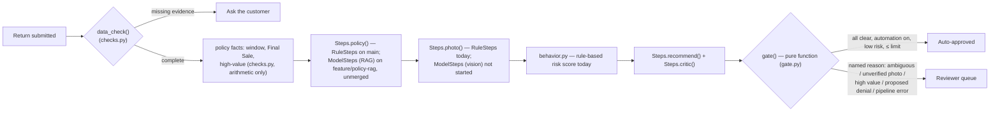

# ReturnGuard — Architecture

> Status as of this document: **M1–M4 are merged to `main`** (skeleton, data model/auth,
> shop/checkout/return submission, pipeline runner + governance gate + worker job-claiming).
> A submitted return is now actually processed end to end — see [§3](#3-the-pipeline). The
> model-backed judgment steps are still rule-based stand-ins on `main`; a real Policy RAG
> step (`ModelSteps.policy()`) exists on the open branch `feature/policy-rag`, not yet merged.
> Image authenticity, behavior risk, and Decision/Critic remain rule-based everywhere — see
> [§5](#5-what-is-and-isnt-real-right-now) for the honest breakdown this doc is built to make
> clear, and `DESIGN_SPEC.md` for the product and UX design this architecture implements.

---

## 1. System diagram

```mermaid
flowchart TB
    subgraph Client
        WEB[Next.js frontend<br/>shop · cart · checkout<br/>returns · review queue · admin]
    end

    subgraph Backend ["FastAPI backend (app/backend)"]
        API[API routers<br/>catalog · orders · returns · review · admin]
        AUTH[auth.py — sessions, roles, rate limiting]
        IMG[images.py — photo validation + storage]
        PAY[payments.py — test-card checkout, no real money]
        WORKER[worker.py — claims jobs, runs the pipeline<br/>wakes on an API HTTP call, not polling]
        PIPE["pipeline/* — checks, gate, behavior, steps, runner<br/>merged, live on main"]
    end

    subgraph Data ["Postgres 16 + pgvector (Neon hosted, or local Docker)"]
        PG[(users · orders · returns · review_requests<br/>policy_docs · policy_chunks[vector]<br/>jobs · agent_runs · audit_log · settings)]
    end

    subgraph Storage ["Object storage"]
        S3[(Neon bucket: return-photos<br/>falls back to app/storage/ locally)]
    end

    subgraph Planned ["Model endpoints — not yet implemented (M5/M6)"]
        LLM[["LLM: Groq or OpenAI<br/>Policy / Decision / Critic steps"]]
        EMB[["Embedding model<br/>policy_chunks.embedding"]]
        VIS[["Image model<br/>match + AI-generation detection"]]
    end

    WEB -- "/api/*, same-origin proxy" --> API
    API --> AUTH
    API --> IMG
    API --> PAY
    API -- "queues a job, wakes the worker over HTTP" --> WORKER
    WORKER --> PIPE
    API --> PG
    WORKER --> PG
    IMG --> S3
    PIPE -. "M5/M6: replaces RuleSteps" .-> LLM
    PIPE -. "M5/M6" .-> EMB
    PIPE -. "M5/M6" .-> VIS
    EMB -. "writes" .-> PG
```

## 2. Layers

### 2.1 Frontend — `app/frontend` (Next.js, App Router)

Server-rendered pages under `src/app/`: `shop`, `cart`, `orders` (+ order detail), `returns/new/[itemId]`
(start a return), `returns/[id]` (status), `review` (reviewer queue), `admin` (automation
settings), plus `login`/`signup`. `src/app/api/[...path]/route.ts` proxies `/api/*` to the
FastAPI backend same-origin, so the browser never talks to the API host directly. Role
gating is client-side (`components/require-role.tsx`) backed by server-side role checks on
every endpoint. A typed API client (`lib/api.ts`, `lib/api-schema.d.ts`) is generated from
the backend's OpenAPI schema (`make api-types`) so the two can't silently drift.

### 2.2 Backend — `app/backend` (FastAPI, Python, `uv`)

- **Routers** (`src/returnguard/routers/`): `catalog` (browse products), `orders`
  (checkout, list/detail), `returns` (submit a return + photo, list/detail, status),
  `review` (the reviewer queue), `admin` (automation settings). Each endpoint is backed by
  a real Postgres query — nothing here is mocked.
- **Cross-cutting**: `auth.py` (session cookies, Argon2 password hashing, role checks),
  `security.py`, `ratelimit.py` (per-address/per-account limits on sign-in and sign-up),
  `images.py` (validates and stores uploaded return photos), `payments.py` (test-card
  checkout only — card number `4242 4242 4242 4242`; no real payment processor is called),
  `storage.py` (S3-compatible client; Neon Object Storage in hosted mode, local disk
  otherwise), `audit.py` (append-only audit log writes), `log_config.py` (structured JSON
  logs with a request ID on every line via `structlog` + `asgi-correlation-id`).
- **Worker** (`worker.py`): a separate process from the API. It claims rows from the
  `jobs` table (`FOR UPDATE SKIP LOCKED`, so multiple workers can run safely) and will run
  the pipeline on each queued return. The API wakes the worker over HTTP the moment it
  queues a job, rather than having the worker poll the database on a timer — Neon suspends
  the database after a few idle minutes, and a periodic poll would keep it awake (and
  billing) around the clock. A long backstop sweep (`WORKER_SWEEP_SECONDS`, default 30 min)
  catches a missed wake-up.
- **Pipeline** (`pipeline/`, merged): see [§3](#3-the-pipeline).

### 2.3 Database — Postgres 16 + pgvector

One schema, two interchangeable targets controlled by `DATABASE_URL`: **Neon** (hosted,
shared team data + live demo) or **local Docker Postgres** (offline work; tests always use
their own local `returnguard_test` database regardless of which one `DATABASE_URL` points
at). Alembic migrations (`app/backend/alembic/versions/`) are the only way the schema
changes. Tables that matter for the AI pipeline specifically:

| Table | Purpose |
|---|---|
| `policy_docs` / `policy_chunks` | The versioned return policy, pre-split into clauses (`P1`…`P9`). `policy_chunks.embedding` is a `vector(1536)` column — present in the schema now, **empty until the embedding job exists** (M5/M6). |
| `jobs` | Durable work queue for the pipeline; one row per return, claimed by the worker. |
| `agent_runs` / `agent_run_events` | One row per pipeline step execution: which step, which model (nullable — `null` today, since every step is still rule-based), prompt version, policy version, input hash, token counts, cost, latency, and any error. This is the observability backbone for `docs/observability.md` and is already wired into the rule-based steps, so switching a step from rules to a model is a `source` field change, not a new logging path. |
| `audit_log` | One row per check, gate decision, and human action — the record a disputed denial is explained from. |
| `settings` | The admin-controlled automation toggle, risk limit, and high-value limit (DESIGN_SPEC §5.6). |

### 2.4 Object storage

Return photos go to a private Neon Object Storage bucket (`return-photos`, declared in
`neon.ts`) in hosted mode, or `app/storage/` on disk for local-only development. The
application code (`storage.py`) is identical either way; only the credentials differ.

### 2.5 Model endpoints

On `main`, no part of the codebase calls an LLM, an embedding model, or an image model —
confirmed by grepping the backend for every model-provider SDK (`openai`, `anthropic`,
`groq`, `langchain`, `langgraph`): the only hit is a code comment. `app/.env.example` has
had blank `OPENAI_API_KEY`/`GROQ_API_KEY` placeholders since M1, but nothing reads them yet.

This has one real exception, not yet on `main`: the open branch `feature/policy-rag` adds
`pipeline/llm.py` (a real OpenAI client, embeddings + chat) and `pipeline/model_steps.py`
(`ModelSteps.policy()`), wired to real `OPENAI_API_KEY`/`EMBEDDING_MODEL`/`POLICY_MODEL`
settings in `config.py`. It's tested (no network needed — the client is behind a `Protocol`)
and passes lint/type-check/the full suite, but it depends on `pipeline/steps.py`'s `Steps`
protocol and hasn't been merged or wired into `worker.py`'s default yet. See
[§5](#5-what-is-and-isnt-real-right-now).

## 3. The pipeline

*(Design: `DESIGN_SPEC.md` §4.1. Code: merged to `main`.)*



Two design choices carry directly from the Checkpoint 2 evidence into this code:

- **The gate is a pure function of check results, not of a model's own decision label**
  (`gate.py`). Checkpoint 2 found a model's stated label (`APPROVE`) could contradict its
  own reasoning (`F2`); the gate never trusts a label on its own.
- **Every judgment step sits behind one `Steps` protocol** (`pipeline/steps.py`), with
  `RuleSteps` (live on `main` — honest about not having checked anything it can't check; an
  unverified photo is never silently waved through) as the default `worker.py` runs with
  today. A `ModelSteps` now exists too (`feature/policy-rag`, unmerged): its `policy()` is
  real retrieval + a real LLM call; `photo`/`recommend`/`critic` still delegate to
  `RuleSteps` by composition. That proves the intended shape works — swapping one step from
  rules to a model is a one-file change, not a rewrite of the runner, the gate, or the
  observability logging in `agent_runs` — but `ModelSteps` isn't merged or wired into
  `worker.py`'s default yet, so `main` still runs on `RuleSteps` alone end to end.

## 4. Governance

The original proposal (`proposal/PROPOSAL.md`) described OPA (Open Policy Agent) and IBM
ContextForge as the governance layer. **That is not what got built.** `DESIGN_SPEC.md` v1 —
written after the Checkpoint 2 evidence — replaced it with a simpler mechanism that is
now actually implemented: `gate.py` is a pure, exhaustively-testable function with four
fixed rules no setting can override:

1. The AI never denies — a proposed denial always routes to a person.
2. An unverified photo is never auto-approved.
3. An ambiguous policy call always routes to a person.
4. A pipeline failure always routes to a person (fail closed).

This document describes the system as it is actually being built, so it follows
`DESIGN_SPEC.md` here rather than the earlier proposal. If OPA/ContextForge is still wanted
for Checkpoint 4, that's a scope decision for the team, not something this doc should
presuppose.

Tracing/metrics: the proposal also named Langfuse and Prometheus/Grafana. Neither is wired
up yet; `agent_runs`/`agent_run_events` plus structured JSON logs are the current
observability mechanism — see `docs/observability.md`.

## 5. What is and isn't real right now

| Component | Status |
|---|---|
| Shop, cart, checkout (test card only) | ✅ Live on `main` |
| Return submission with photo upload | ✅ Live on `main` |
| Auth, roles, rate limiting | ✅ Live on `main` |
| Reviewer queue, admin settings (read views) | ✅ Live on `main` |
| Data-quality check, policy window/value arithmetic | ✅ Live on `main` (`checks.py`) |
| Pipeline runner, governance gate, worker job-claiming | ✅ Live on `main` |
| `docs/observability.md` | ✅ Live on `main` |
| Policy RAG (embed `policy_chunks`, retrieve, LLM-ground a decision) | 🟡 Open branch `feature/policy-rag`, not merged — `ModelSteps.policy()`, tested (9 tests, no network needed), CI-clean |
| Photo match / AI-generated-image detection | ❌ Not started on any branch |
| Behavior risk model | ❌ Rule-based stand-in only (`behavior.py`); no model |
| Decision + Critic agents | ❌ Not started — `RuleSteps` stands in for both |
| `app/prompts/` content | 🟡 `policy.md` exists on `feature/policy-rag`; everything else is still just the `README.md` |
| OPA / ContextForge / Langfuse / Prometheus | ❌ Named in the original proposal; not built, and superseded in `DESIGN_SPEC.md` by `gate.py` + `agent_runs` |

This table is the honest version of the diagram in §1 — every box there is real as *shape*
(the data model, the protocol, the queue all exist and are tested), but the "Planned" model
endpoints are not wired to anything yet.
